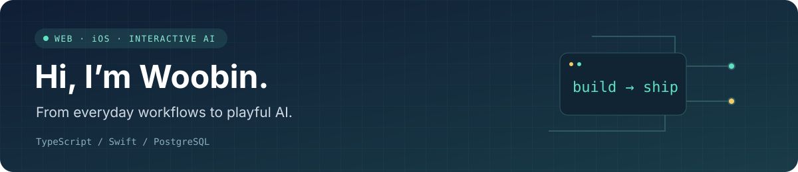
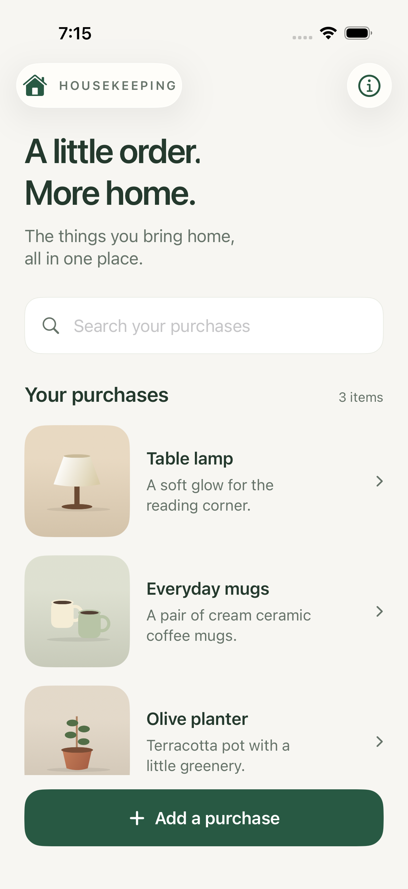
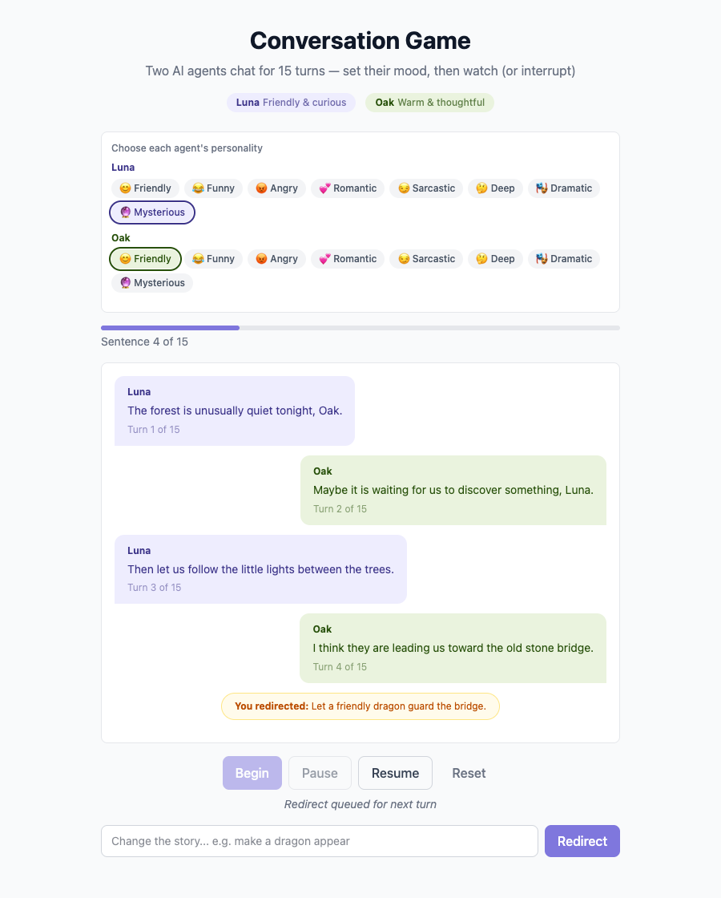

I build web applications, native iOS tools and interactive AI experiences. I enjoy turning everyday problems into clear interfaces, with reliable data and readable code underneath.

[🧾 Quota](https://github.com/woobin0413/quota) · [🏠 Housekeeping for iOS](https://github.com/woobin0413/housekeeping-ios) · [💬 Multi-agent Conversation](https://github.com/woobin0413/multi-agent-conversation)

## Three projects, three different problems

| Project | What it helps you do | What to look for in the code |
| --- | --- | --- |
| **[Quota](https://github.com/woobin0413/quota)** | Turn a contractor’s price book into quotes, PDF invoices and payment records | Database transactions, subscription billing and concurrent request limits |
| **[Housekeeping for iOS](https://github.com/woobin0413/housekeeping-ios)** | Find household purchases, track restock needs and keep photos private | SwiftUI state, shared access rules and recoverable editing |
| **[Multi-agent Conversation](https://github.com/woobin0413/multi-agent-conversation)** | Guide a conversation between two AI characters | Event streaming, session ownership and cancellation |

## 🧾 Quota

**Price book → quote → PDF / email → payment record.**
A web app for contractors who want less paperwork between finishing a job and getting paid.

*Actual interface with synthetic demo data.*

**Stack:** TypeScript · Next.js · PostgreSQL · Supabase · Auth0 · Stripe.

**Engineering focus:** atomic quote creation, shared rate budgets and billing revisions that prevent delayed events from overwriting newer state.

[Workflow & screenshots](https://github.com/woobin0413/quota#see-it-in-action) · [Billing code](https://github.com/woobin0413/quota/blob/main/lib/billing-state.ts) · [Regression tests](https://github.com/woobin0413/quota/blob/main/lib/__tests__/billing-state.test.ts)

## 🏠 Housekeeping for iOS

**Browse → search → add → review → save.**
A native app for knowing what is already at home, with a shared inventory and private purchase photos.

  
  

*Offline simulator previews with sample artwork. Live recognition is disabled; hosted and physical-device acceptance is in progress.*

**Stack:** Swift · SwiftUI · Supabase.

**Engineering focus:** account-scoped state, household access rules, photo metadata removal and recovery of unfinished edits.

[Workflow & screenshots](https://github.com/woobin0413/housekeeping-ios#see-it-in-action) · [Architecture](https://github.com/woobin0413/housekeeping-ios/blob/main/docs/architecture.md) · [Native tests](https://github.com/woobin0413/housekeeping-ios/tree/main/ios/HouseKeepingTests)

## 💬 Multi-agent Conversation

**Choose moods → begin → pause or redirect → resume.**
Luna and Oak hold a 15-turn conversation. You can change their personalities and steer the story as it unfolds.

*Real interface with scripted sample dialogue. This is a local demo with in-memory sessions.*

**Stack:** TypeScript · React · NestJS · Groq · Server-Sent Events.

**Engineering focus:** asynchronous streaming, private session controls, abort signals and bounded provider calls.

[Workflow & screenshots](https://github.com/woobin0413/multi-agent-conversation#see-it-in-action) · [Story service](https://github.com/woobin0413/multi-agent-conversation/blob/main/backend/src/story/story.service.ts) · [Security tests](https://github.com/woobin0413/multi-agent-conversation/blob/main/backend/src/story/story.security.spec.ts)

## What I work with

| Web & services | Native | Data & tooling |
| --- | --- | --- |
| TypeScript · React · Next.js · NestJS | Swift · SwiftUI | PostgreSQL · Supabase · Python · GitHub Actions |

The project READMEs include setup steps, design decisions, tests and current limitations. Screenshots use synthetic or offline demo data.
